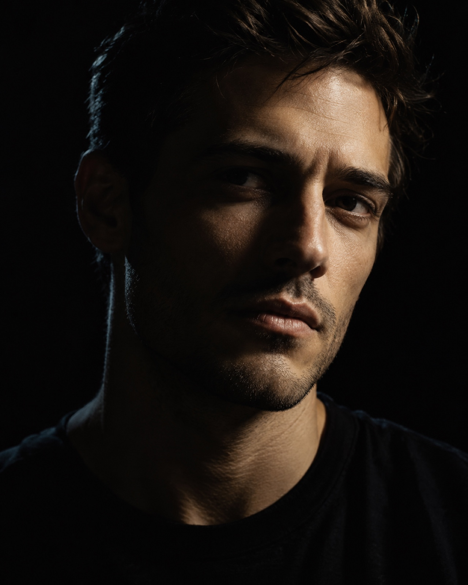
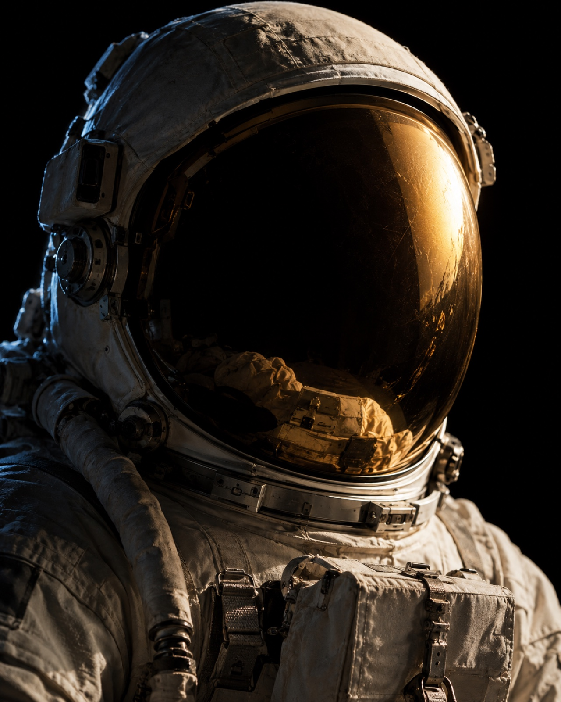
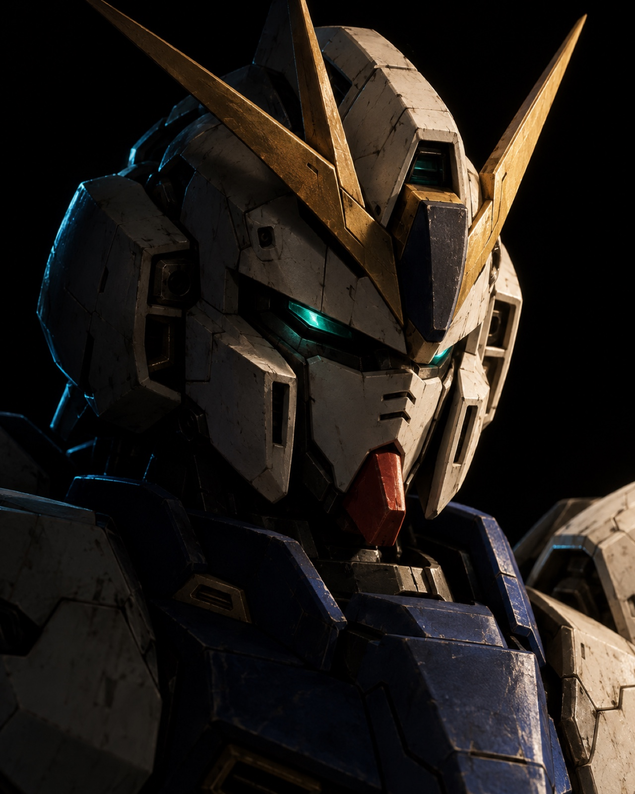
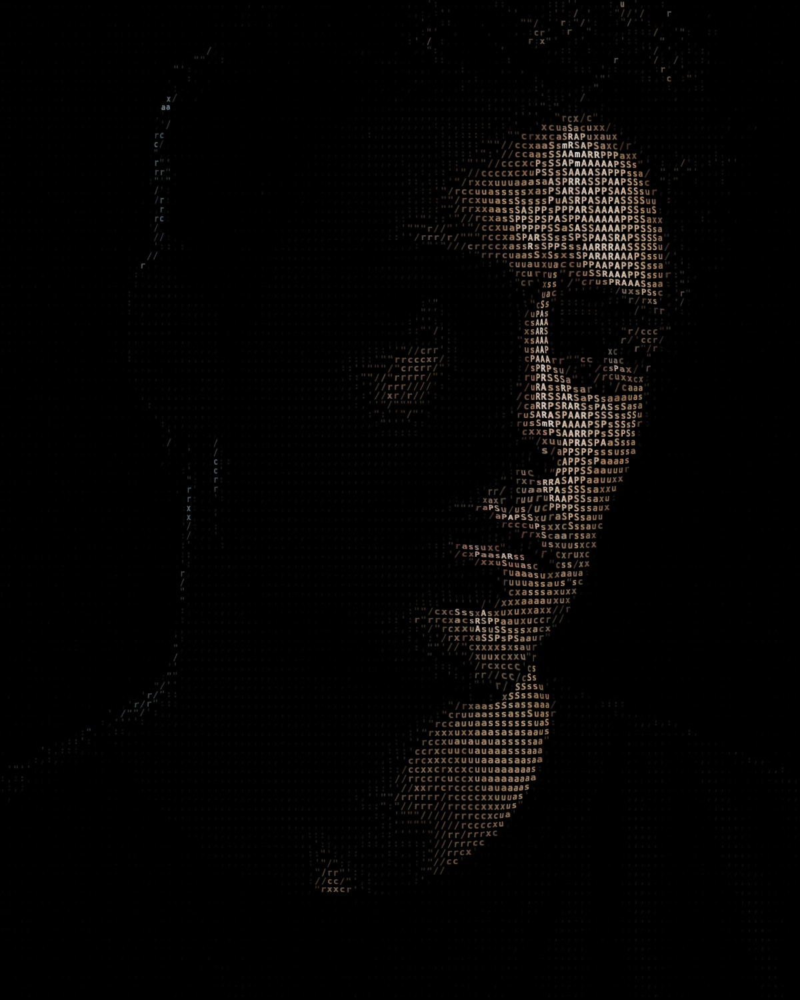
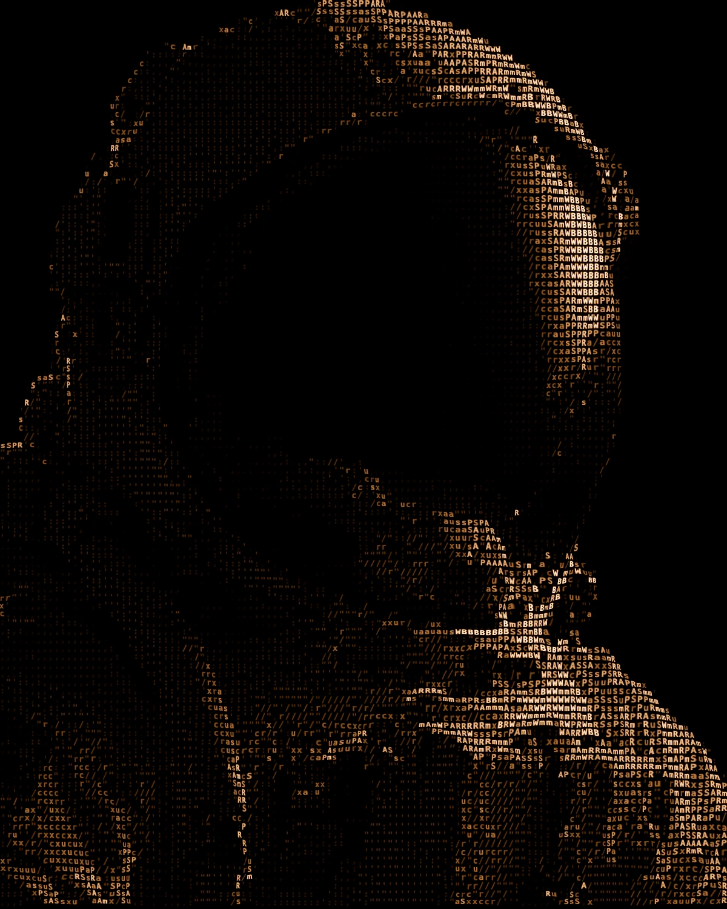
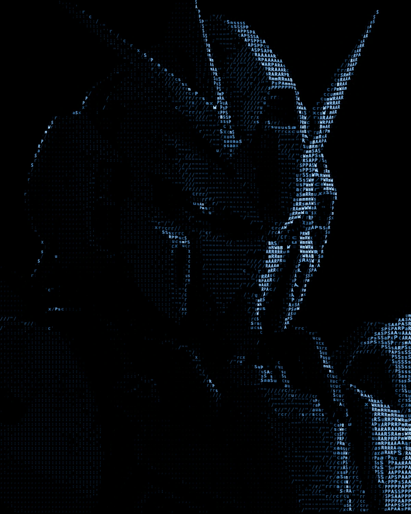

# ASCII Portrait Studio

[English](./README.md) · [简体中文](./README.zh-CN.md) · **日本語** · [Español](./README.es.md)

ブラウザ上で写真を動く ASCII ポートレートに変換し、PNG 画像、または継ぎ目なくループする 6 秒の動画として書き出せます。写真がデバイスの外に送信されることはありません。

**[オンラインで試す →](https://ethannju.github.io/ascii-portrait/)**

https://github.com/user-attachments/assets/ceb3b831-9312-4d70-a9b9-8a16b6d99dea

<sub>[高画質版の動画（1080p）](./media/ascii-portrait-demo.mp4)</sub>

## 作例

| ポートレート · Original color | 宇宙飛行士 · Amber | メカ · Cobalt |
| :-: | :-: | :-: |
|  |  |  |
|  |  |  |

上段が元画像、下段が Studio の出力です（グリッド 8、19 段階）。画像をクリックすると原寸で表示されます。3 枚の元画像は、Studio に内蔵されている AI 生成のデモ素材です（[素材の出典](./assets/PROVENANCE.md)）。

## 仕組み

1. **明るさ → 文字**：写真をグリッド状にサンプリングし、各セルの明るさに応じて、薄い文字から濃い文字まで 19 段階または 27 段階の文字セットから 1 文字を選びます。文字はそのセルの色を保ちます（Monochrome、Signal green、Amber、Cobalt のパレットにも切り替えられます）。
2. **人物の切り抜き**：ブラウザ内で動くセグメンテーションモデル（TensorFlow.js、MediaPipe Selfie Segmentation）で被写体と背景を分離します。モデルが使えない場合は写真全体を使います。
3. **変位とアニメーション**：明るさから作った 2D フィールドで画像を WebGL で変位させ、その上で文字をアニメーションさせます。3D 復元は行いません。
4. **フレーム単位の書き出し**：動画は固定のタイムラインに沿って 1 フレームずつ描画し、WebCodecs で 24 fps の WebM にエンコードするので、継ぎ目なくループします。処理の遅いパソコンでは書き出しに時間がかかるだけで、フレームが抜けることはありません。

## 使い方

[オンライン版](https://ethannju.github.io/ascii-portrait/)を開くか、Node.js 22 以上でローカル実行します（依存パッケージもビルドも不要です）。

```bash
git clone https://github.com/Ethannju/ascii-portrait.git
cd ascii-portrait
npm run dev        # http://127.0.0.1:4173 を開く
```

1. 写真をドロップするか、**Demos** からサンプルを選びます。
2. Inspector でグリッドサイズ、色、変位、モーションを調整します。
3. **PNG still** か **Looping video · 6s** を選び、**Export** をクリックします。

画面の表示言語は英語と中国語のみで、日本語には未対応です。動画の書き出しには WebCodecs が必要で、macOS の Chrome 154 と Safari 26.4 で動作を確認しています。それ以外の環境では PNG を書き出してください。人物の切り抜きは、初回にモデルを CDN からダウンロードします。変更を送る前に `npm test` を実行してください。

最後に使った写真と設定はご自身のブラウザ内にだけ保存され、ページを開き直すと復元されます。アップロードは一切行われず、ほかの訪問者には常に初期画面が表示されます。削除するには、Inspector の **Scene** セクションにある **Clear local data** をクリックしてください。

### きれいに仕上げるコツ

Studio は写真にもともとある光と影を文字に置き換えるため、どの設定よりも元の写真が仕上がりを左右します。理想は**黒背景でスタジオ照明を使った、明暗のコントラストが強いポートレート**です。顔の片側に強い光が当たり、反対側は深い影に沈み、顔が画面の大部分を占めている写真が向いています。光が均一な自撮りや、ごちゃごちゃした背景は、文字にするとノイズのようになってしまいます。

手元の写真が条件に合わない場合は、画像生成 AI（ChatGPT や Gemini など）で先にライティングを変えてから、その画像をアップロードしてください。プロンプト例：

> この写真を、同じ人物のローキーなスタジオポートレートにしてください。顔、本人らしさ、髪型、表情は変えないでください。背景は継ぎ目のない真っ黒。暖かい白色の硬いキーライトを横のやや上から当てて、片側の額・鼻筋・頬骨・あごを照らし、顔の反対側は深い影に落としてください。暗い側の髪と肩には、細く冷たい色のリムライトを入れてください。頭から肩までの構図で顔を大きく、縦長 4:5 で。写真のようにリアルに、瞳はシャープに、肌の質感は自然に、ハイライトのディテールは残してください。文字、小物、透かしは入れないでください。

使う写真は、ご自身の写真か、使用の許可を得た写真に限ってください。

## ライセンス

コード：[MIT](./LICENSE)。デモ画像とメディア：[ASSET-LICENSE.md](./ASSET-LICENSE.md)。
